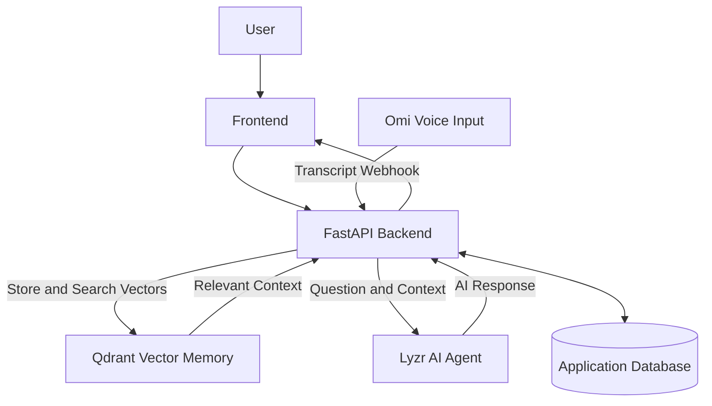

# MediSchedule AI 🩺

**AI-Powered Healthcare Appointment Scheduling Platform**

MediSchedule AI is a web-based healthcare appointment scheduling platform designed to simplify patient registration, doctor management, and appointment booking. It aims to make healthcare interactions more natural by combining voice-based input, vector memory, and AI-powered assistance.

## 🚀 Features

- **Patient Registration:** Register and manage patient details.
- **Doctor Management:** Add doctors with their specializations and availability.
- **Appointment Booking:** Schedule and view patient appointments.
- **Voice Assistant:** Interact with the platform through a voice interface.
- **AI-Powered Assistance:** Integrate AI agents to support conversational interactions.
- **Vector Memory:** Use Qdrant to store and retrieve relevant conversation information.
- **REST API:** Manage application functionality through a FastAPI backend.

## 🛠️ Technology Stack

| Technology | Purpose |
|---|---|
| HTML, CSS, JavaScript | Frontend interface |
| Python | Backend programming |
| FastAPI | REST API and backend services |
| Omi | Voice input and conversation transcripts |
| Qdrant | Vector database and semantic memory retrieval |
| Lyzr | AI agent reasoning and response generation |
| FastEmbed | Text embedding generation |
| SQLite | Application data storage, where configured |

## 🏗️ System Architecture

The intended architecture connects voice input, backend processing, vector memory, and AI reasoning.



**Workflow:**

1. The user interacts with MediSchedule AI through the website or voice interface.
2. Omi provides conversation transcripts to the backend through webhooks.
3. FastAPI processes incoming information.
4. Qdrant stores vector embeddings and retrieves semantically relevant memories.
5. The backend passes the user's question and retrieved context to the Lyzr agent.
6. The generated response is returned to the application.

*Note: The complete Omi–Qdrant–Lyzr workflow must be tested end to end in the deployed environment.*

## 📁 Project Structure

```text
MediSchedule/
├── backend/
│   ├── app.py
│   ├── requirements.txt
│   └── qdrant_test.py
├── frontend/
│   ├── index.html
│   ├── script.js
│   └── style.css
└── README.md
```

## ⚙️ Installation and Setup

### Prerequisites

- Python 3.10 or newer
- Git
- pip
- Required API credentials for the integrations you enable

### 1. Clone the Repository

```bash
git clone https://github.com/rajavarshitha30/MediSchedule.git
cd MediSchedule
```

### 2. Create a Virtual Environment

**Windows PowerShell:**

```powershell
python -m venv .venv
.\.venv\Scripts\Activate.ps1
```

### 3. Install Dependencies

```powershell
cd backend
pip install -r requirements.txt
```

### 4. Configure Environment Variables

Configure the API credentials required by your backend through environment variables or your deployment provider's secret settings.

Example placeholders:

```env
LYZR_API_KEY=your_lyzr_api_key
LYZR_AGENT_ID=your_lyzr_chat_agent_id
LYZR_VOICE_API_KEY=your_lyzr_voice_api_key
LYZR_VOICE_AGENT_ID=your_lyzr_voice_agent_id
```

Use the exact variable names expected by your current backend code. Never commit real API keys or `.env` files to GitHub.

### 5. Run the Backend

From the `backend` directory:

```bash
uvicorn app:app --reload
```

Open the API documentation at:

http://127.0.0.1:8000/docs

### 6. Run the Frontend

Serve the `frontend` directory through a local development server or use the frontend route configured in the FastAPI application.

Make sure the frontend API URL points to the correct backend address.

## 🧠 Qdrant Configuration

Qdrant provides vector storage and semantic search capabilities for conversation memory.

The project has used local embedded Qdrant storage. If deploying to a cloud environment, ensure the configured database is accessible to the backend and that memory persists across restarts.

## 🌐 Live Project

- **GitHub Repository:** https://github.com/rajavarshitha30/MediSchedule
- **GitHub Profile:** https://github.com/rajavarshitha30
- **Live Frontend:** https://medischedule2.onrender.com
- **Backend API:** https://medischedule-26s2.onrender.com

*Live links and service availability should be verified before submission.*

## 🔐 Security and Privacy

- Store API credentials securely in environment variables.
- Do not upload passwords, API keys, or private patient information.
- Use synthetic data for public demonstrations.
- Implement appropriate authentication, authorization, and data protection before real-world healthcare use.

## 🔮 Future Enhancements

- Improved conversational appointment scheduling.
- More reliable integration between Omi, Qdrant, and Lyzr.
- Persistent cloud-based vector memory.
- Enhanced doctor availability management.
- Better error handling, monitoring, and user experience.

## 🏆 Hackathon Project

MediSchedule AI is being developed for the **Stop Prompting, Solo Agents Hackathon**.

The project explores how voice interaction, vector memory, and AI agents can work together to provide more contextual and accessible appointment-management assistance.

## 📄 License

A license has not yet been specified. Add a `LICENSE` file if you intend to publish the project under an open-source license.

---

**MediSchedule AI — Making patient scheduling smarter, one conversation at a time.**
